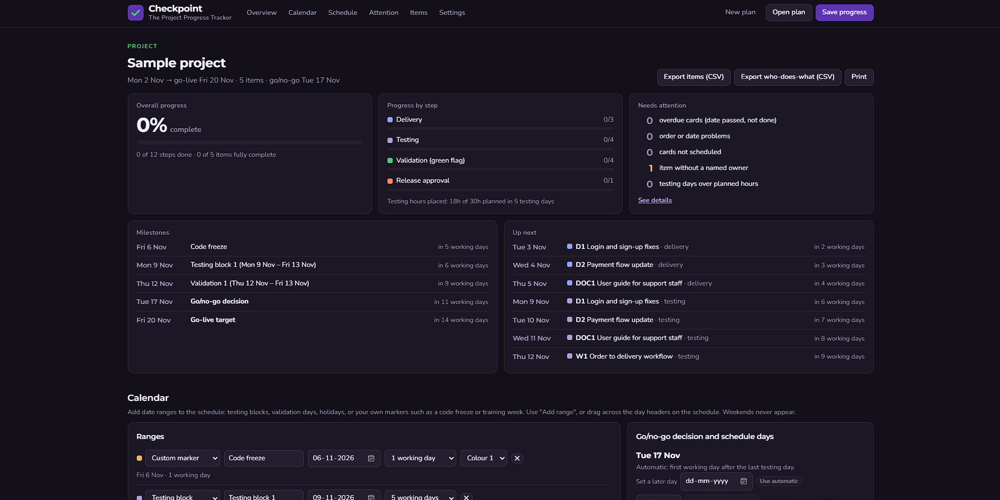

# Checkpoint

**The Project Progress Tracker**

*Progress saved. What's next?*

Checkpoint is a lightweight, single-file tracker for getting a project ready to go live. It follows every deliverable through four steps on one schedule:

1. **Delivery**: the development team hands the item over on a date.
2. **Testing**: your team tests it, with estimated hours and days.
3. **Green flag (validation)**: a named stakeholder confirms it is good to go.
4. **Release approval**: a named approver gives the formal sign-off.

It runs entirely in your browser. There is no server, no account and no install. Your plan is kept in the browser and in plan files you save, so you can pick it up again any time.



## Quick start

1. Download `index.html` (or the whole repository) and open it in Chrome, Edge, Firefox or Safari.
2. The first time, you'll see a small sample project. To start fresh, click **New plan → Blank plan**.
3. In **Settings**, name the project, set the start and go-live target dates, and rename the rows and teams to match your project.
4. In **Calendar**, add a **testing block**. This also sets the go/no-go decision day.
5. Click **Add item** to add your deliverables, then drag the cards onto the right days.
6. Click **Save progress** to download a plan file. Use **Open plan** to continue later, or to open a plan a colleague sent you.

To share it with your team, publish the repository with GitHub Pages (Settings → Pages → deploy from the `main` branch). Each person's plan still stays in their own browser.

## What you see

**Overview**
- Overall completion, based on the actual status of every step.
- Progress for each step (delivery, testing, green flag, approval).
- **Needs attention**: overdue cards, order problems, unscheduled cards, missing owners and overloaded testing days.
- **Milestones** with how many working days away they are.
- **Up next**: the next steps due.

**Calendar**
- Add date ranges with **Add range**, or by dragging across the day headers on the schedule:
  - *Testing block*: days set aside for testing, counted in working days.
  - *Validation days*: days for green flags, counted inside the testing blocks.
  - *Holiday / no work*: counted in calendar days.
  - *Custom marker*: anything else, such as a code freeze, UAT window or training week.
- **Go/no-go decision**: automatically the first working day after the last testing day. You can set a later day.
- **Add a day**: extends the schedule with empty days you can move cards into.

**Schedule**
- One row per step. Rename any row, name the team responsible, or hide rows you don't use.
- Drag cards to any weekday, or back to "Not scheduled". Nothing moves on its own, and weekends never appear.
- The × on a card removes it from that row only.
- Today, testing blocks, holidays, markers, the go/no-go decision and the go-live target are all marked on the schedule.

**Items**
- **Add item** asks which row the card is for, then whether the item needs linked cards in other rows.
- **Groups**: each group shows its own progress, with quick links at the top of the table.
- **Stakeholders**: tag who's involved, who gives each green flag and who approves.
- **Testing**: hours per item, and items that run over several days.
- **"Done when"**: a description for each item, plus a status for each step.
- **"Waits for"**: a dependency on another item, for example `D3` (after it's delivered), `D3:T` (after it's tested), `D3:G` (after its green flag) or `D3:P` (after approval).

**Checks (highlights only)**
- Days over the planned testing hours turn red.
- Cards out of order, or not done before the go/no-go decision, get a red outline.
- Approvals after the go-live target are flagged.

**Sharing**
- **Export items (CSV)** and **Export who-does-what (CSV)** open in Excel or Google Sheets, which is the easiest way to share the plan with stakeholders who don't use Checkpoint.
- **Print** gives a light, paper-friendly copy.

**Auto-arrange**
- Spreads testing and green-flag cards across your testing blocks and validation days in priority order, as a starting point.

## Your data

- The plan is stored in your browser's local storage for this page. Clearing site data removes it, so use **Save progress** regularly.
- Plan files are plain JSON. See [`examples/sample-plan.json`](examples/sample-plan.json).
- The only network request is for the Montserrat and Nunito fonts from Google Fonts. Offline, Checkpoint works the same with system fonts. Your plan data is never sent anywhere.

## Plan file format (summary)

```jsonc
{
  "settings": {
    "project": "My project",
    "start": "2026-11-02",          // first day shown
    "target": "2026-11-20",         // go-live target
    "cap": 6,                       // planned testing hours per day (guide)
    "decision": "",                 // empty = automatic go/no-go day
    "sections": { "DEV": {...}, "TEST": {...}, "VAL": {...}, "APR": {...} },
    "groups": ["Development", "Documents", "Workflow test", "Final checks"],
    "ranges": [ { "type": "test", "name": "Testing block 1", "start": "2026-11-09", "days": 5 } ]
  },
  "cap": { "2026-11-10": 2 },       // per-day testing hour overrides
  "items": [
    {
      "id": "D1", "name": "Login fixes", "group": "Development", "who": "Dev team",
      "has": { "DEV": true, "TEST": true, "VAL": true, "APR": false },
      "due": "2026-11-03", "tday": "2026-11-09", "span": 1, "vday": "2026-11-12", "aday": "",
      "h": { "TEST": 4, "VAL": 1 }, "gf": "Product owner", "appr": "",
      "deps": "", "done": "All login bugs fixed",
      "st": { "DEV": 0, "TEST": 0, "VAL": 0, "APR": 0 }   // 0 not started, 1 in progress, 2 done
    }
  ]
}
```

Range types are `test`, `val`, `off` (holiday) and `mark` (custom marker, with a `color` of `m1` to `m5`).

## Design

- **Dark interface** with Primary Purple `#5E35B1` and Mint `#50C878` accents.
- **Typography**: Montserrat for headings, Nunito for interface text.
- **One file**: everything lives in `index.html`, in plain HTML, CSS and JavaScript, with no build step and no dependencies. The colours are CSS variables at the top of the file.

## License

MIT. See [LICENSE](LICENSE).
